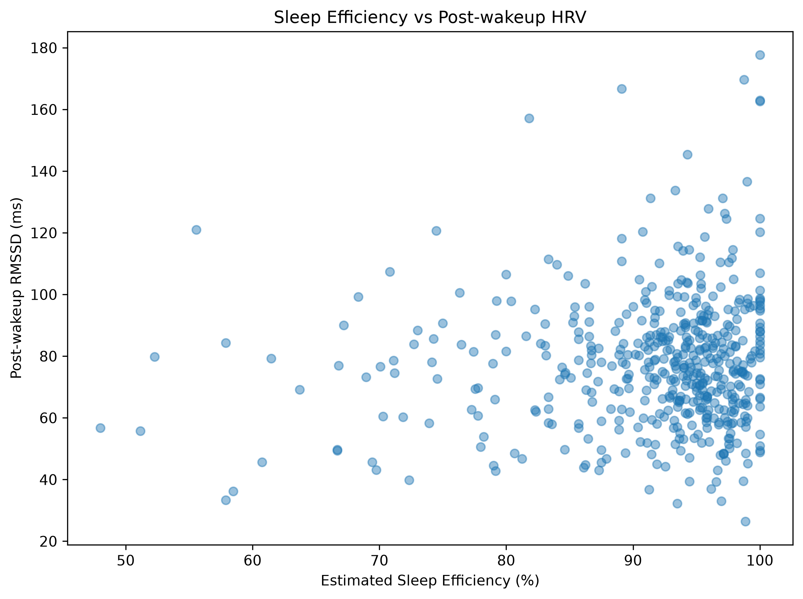

# Sleep Efficiency and Post-Wakeup Heart Rate Variability

An exploratory longitudinal analysis investigating the relationship between sleep characteristics and post-wakeup heart rate variability (HRV) using wearable sensor data and self-reported sleep diaries.

Python · pandas · SciPy · statsmodels · Mixed-effects modeling · Wearable data

## Research Question

Is sleep quality associated with post-wakeup heart rate variability?

More specifically, this project investigates whether estimated sleep efficiency is associated with RMSSD measured during the first two hours after self-reported wake-up time.

## Why This Matters

Heart rate variability is widely used in human performance and recovery monitoring. However, HRV varies substantially between individuals, making longitudinal analysis and appropriate handling of repeated measurements essential.

This project explores whether sleep characteristics are associated with next-morning autonomic regulation while accounting for participant-level differences.

## Dataset

The analysis uses a public wearable-based dataset containing:

- Self-reported sleep diary data
- Wearable-derived heart rate variability metrics
- Participant-level survey information

The final analytical sample included 47 participants and 493 valid participant-days after data-quality filtering.

## Methodology

Sleep quality was estimated using:

- Time in bed
- Sleep latency
- Wake After Sleep Onset (WASO)

Estimated total sleep time was calculated as:

`time in bed - sleep latency - WASO`

Estimated sleep efficiency was then calculated as:

`estimated total sleep time / time in bed`

For HRV, RMSSD measurements were aligned to each participant's self-reported wake-up time. Only measurements collected within the first two hours after waking were retained.

To improve measurement reliability:

- At least 3 valid HRV windows were required per participant-day.
- The median RMSSD was used to summarize post-wakeup HRV.
- Repeated measurements within participants were modeled using a random-intercept mixed-effects model.

## Results

Estimated total sleep time showed no evidence of a monotonic association with post-wakeup RMSSD:

- Spearman rho = 0.006
- p = 0.897

Estimated sleep efficiency also showed only a weak unadjusted association with post-wakeup RMSSD:

- Spearman rho = 0.057
- p = 0.208

However, after accounting for repeated measurements within participants using a random-intercept mixed-effects model, higher estimated sleep efficiency was associated with higher post-wakeup RMSSD:

- β = 33.32
- p = 0.005
- 95% CI: 9.87 to 56.77

Because sleep efficiency was modeled from 0 to 1, this corresponds to approximately **3.33 ms higher RMSSD for each 10-percentage-point increase in estimated sleep efficiency**.

## Interpretation

The main finding suggests that sleep efficiency may be more informative than sleep duration alone when examining short-term autonomic recovery.

The mixed-effects model was important because HRV varies substantially between individuals, and repeated observations from the same participant should not be treated as independent.

These findings describe an association, not a causal effect.

## Limitations

- Sleep data were self-reported through sleep diaries.
- HRV was summarized using measurements collected within two hours after self-reported wake-up time.
- Two participants were excluded after data-quality filtering.
- Potential confounders such as training load, physical activity, stress, caffeine, alcohol, and illness were not included in the final model.
- The analysis is observational and does not support causal conclusions.

## Tech Stack

- Python
- pandas
- NumPy
- Matplotlib
- SciPy
- statsmodels
- Jupyter Notebook

## Repository Contents

- `notebooks/01_data_exploration.ipynb` — complete data cleaning, feature engineering, exploratory analysis, correlation tests, and mixed-effects modeling
- `figures/sleep_efficiency_vs_hrv.png` — main visualization of estimated sleep efficiency versus post-wakeup RMSSD
- `data/raw/` — raw sleep diary, HRV, and survey datasets used in the analysis
- `requirements.txt` — Python dependencies required to reproduce the analysis

## Main Takeaway

Higher estimated sleep efficiency was associated with higher post-wakeup RMSSD after accounting for repeated measurements and participant-level baseline differences.

This project highlights the importance of individualized analysis when working with longitudinal wearable and human performance data.